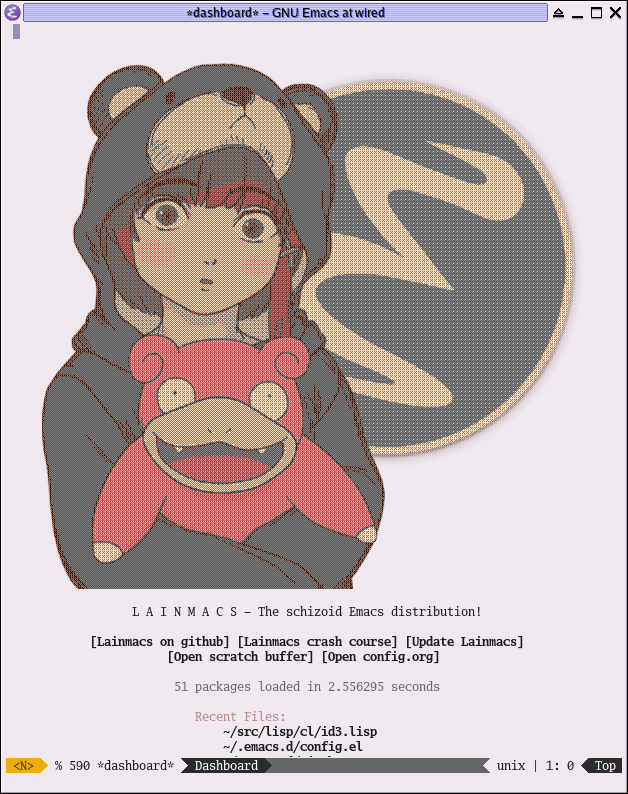

#+STARTUP: overview
#+TITLE: Lainmacs
#+LANGUAGE: en
#+OPTIONS: num:nil
The least sane Emacs distribution

* Introduction
Lainmacs is a very simple and basic configuration file for Emacs. From here you can edit, remove, or add many aspects of Emacs you want. I encourage you to do so, because Emacs works best when it's customized to your own liking!
* Why would I use this?
#+BEGIN_QUOTE
What's the difference between a villain and a super villain? Presentation!
#+END_QUOTE
Currently, the appeal of Lainmacs is seeing a schizo Lain picture everytime you start up Emacs. Also, it is a very basic config which means you can easily add, edit or remove things as you like. You can use this as a building block when making your OWN Emacs config!

#+BEGIN_QUOTE
Ogres are like onions

They smell?

Yes - No! layers! onions have layers! ogres have layers!
#+END_QUOTE
As opposed to many other Emacs distributions, Lainmacs has ZERO customization layers which means you can just jump in, look at the config file and start editing away! After all, Emacs works best when it's customized to your own liking!
* Quick install
#+BEGIN_SRC bash
git clone https://github.com/shampee/Lainmacs ~/.emacs.d
#+END_SRC
After running this command, the first time you run Emacs will download all of the specified packages in the config.org file, so please be patient!

For C, C++ and Java completion, install the corresponding language servers. Corfu displays completion candidates from their completion-at-point backends.
* Dependencies
* Things-to-do
- Add and configure some extra packages
  + +Configure Lisp+
  + +Configure Scheme+
- +Make dashboard cooler+
  + Make dashboard EVEN cooler!
  + Maybe add rotating dashboard pictures
- +Make custom Lainmacs theme+
  + (Maybe) Make a random Lain pop up on the dashboard every time you launch.
- +Clean up/organize init.el+
  + Clean up/organize config.org
- Optimize startup time
* Lexical binding
This block must stay the first =emacs-lisp= block so the cookie lands on the first line of the tangled =config.el=.
#+BEGIN_SRC emacs-lisp
;;; config.el --- Tangled from config.org  -*- lexical-binding: t; -*-
#+END_SRC
* QoL section
Minor quality-of-life modifications for a more pleasant Emacs experience
** Enable line numbers
Emacs breaks certain modes when it has line-numbers-mode enabled, (like docview or ansi-term) so I utilize the approach of only enabling it on some major modes rather than globally
#+BEGIN_SRC emacs-lisp
(add-hook 'prog-mode-hook 'display-line-numbers-mode)
(add-hook 'text-mode-hook 'display-line-numbers-mode)
#+END_SRC
** Show parent parentheses
#+BEGIN_SRC emacs-lisp
(show-paren-mode 1)
#+END_SRC
** Disable the default startup screen
#+BEGIN_SRC emacs-lisp
(setq inhibit-startup-message t)
#+END_SRC
** Disable most gui elements
#+BEGIN_SRC emacs-lisp
(when (fboundp 'tool-bar-mode) (tool-bar-mode -1))
(menu-bar-mode -1)
(when (fboundp 'scroll-bar-mode) (scroll-bar-mode -1))
#+END_SRC
** Backups and crash recovery
Store recovery files in private directories under the Emacs cache.
#+BEGIN_SRC emacs-lisp
(let* ((recovery-dir (expand-file-name ".cache/recovery/" user-emacs-directory))
       (backup-dir (expand-file-name "backups/" recovery-dir))
       (auto-save-dir (expand-file-name "auto-save/" recovery-dir)))
  (dolist (directory (list recovery-dir backup-dir auto-save-dir))
    (make-directory directory t)
    (set-file-modes directory #o700))
  (setq make-backup-files t
        auto-save-default t
        backup-directory-alist `(("." . ,backup-dir))
        auto-save-file-name-transforms `((".*" ,auto-save-dir t))
        auto-save-list-file-prefix (expand-file-name ".saves-" recovery-dir)
        backup-by-copying t
        version-control t
        kept-new-versions 6
        kept-old-versions 2
        delete-old-versions t))
#+END_SRC
** Disable ring-bell
#+BEGIN_SRC emacs-lisp
(setq ring-bell-function 'ignore)
#+END_SRC
** Indentation
#+BEGIN_SRC emacs-lisp
(setq-default tab-width 4)
(setq-default standard-indent 4)
(setq c-basic-offset tab-width)
(setq-default electric-indent-inhibit t)
(setq-default indent-tabs-mode nil) ;; fuark no!
(setq backward-delete-char-untabify-method 'nil)
#+END_SRC
** Enable prettify symbols mode
#+BEGIN_SRC emacs-lisp
(global-prettify-symbols-mode t)
#+END_SRC
** Enable bracket pair-matching
#+BEGIN_SRC emacs-lisp
(setq electric-pair-pairs '((?\{ . ?\})
                            (?\( . ?\))
                            (?\[ . ?\])
                            (?\" . ?\")))

(electric-pair-mode t)
#+END_SRC
** Creating a new window switches your cursor to it
#+BEGIN_SRC emacs-lisp
(defun split-and-follow-horizontally ()
  (interactive)
  (split-window-below)
  (balance-windows)
  (other-window 1))
(global-set-key (kbd "C-x 2") 'split-and-follow-horizontally)

(defun split-and-follow-vertically ()
  (interactive)
  (split-window-right)
  (balance-windows)
  (other-window 1))
(global-set-key (kbd "C-x 3") 'split-and-follow-vertically)
#+END_SRC
** Transform yes-or-no questions into y-or-n
#+BEGIN_SRC emacs-lisp
(setq use-short-answers t)
#+END_SRC
** Easier resize bindings
Super - Control - <arrow>
#+BEGIN_SRC emacs-lisp
(global-set-key (kbd "s-C-<left>") 'shrink-window-horizontally)
(global-set-key (kbd "s-C-<right>") 'enlarge-window-horizontally)
(global-set-key (kbd "s-C-<down>") 'shrink-window)
(global-set-key (kbd "s-C-<up>") 'enlarge-window)
#+END_SRC
** Highlight current line
#+BEGIN_SRC emacs-lisp
(global-hl-line-mode t)
#+END_SRC
** Defer loading most packages for quicker startup times
#+BEGIN_SRC emacs-lisp
(setq use-package-always-defer t)
#+END_SRC
** Verify signed packages
#+BEGIN_SRC emacs-lisp
(setq package-check-signature 'allow-unsigned)
#+END_SRC
** Set default browser
#+BEGIN_SRC emacs-lisp
(setq browse-url-browser-function #'eww-browse-url)
#+END_SRC
** Scroll in =eww= without changing point
#+BEGIN_SRC emacs-lisp
(add-hook 'eww-mode-hook 'scroll-lock-mode)
#+END_SRC
** No warnings for redefinition
#+BEGIN_SRC emacs-lisp
(setq-default ad-redefinition-action 'accept)
#+END_SRC
** Ergonomic additional site-lisp directory
#+BEGIN_SRC emacs-lisp
(let ((directory (expand-file-name "site-lisp/" user-emacs-directory)))
  (make-directory directory t)
  (add-to-list 'load-path directory))
#+END_SRC
** Ergonomic Info directory
#+BEGIN_SRC emacs-lisp
(make-directory (expand-file-name "info/" user-emacs-directory) t)
(with-eval-after-load 'info
  (add-to-list 'Info-directory-list
               (expand-file-name "info/" user-emacs-directory)))
#+END_SRC
** Compilation mode ansi colors
#+BEGIN_SRC emacs-lisp
(use-package ansi-color
    :hook (compilation-filter . ansi-color-compilation-filter))
#+END_SRC
** Dictionary lookup
#+BEGIN_SRC emacs-lisp
(with-eval-after-load 'evil
  (define-key evil-normal-state-map (kbd "z d") #'dictionary-lookup-definition))
#+END_SRC
** Display column number in the modeline
#+BEGIN_SRC emacs-lisp
(column-number-mode t)
#+END_SRC
** Upgrade builtins
#+BEGIN_SRC emacs-lisp
(setq package-install-upgrade-built-in t)
#+END_SRC
* Secrets
#+BEGIN_SRC emacs-lisp
(defvar lib/server "irc.libera.chat")
(defvar lib/nick nil                   "The ERC libera nick to use.")
(defvar lib/password nil               "The ERC libera password to use.")
(defvar lib/port nil                   "The ERC libera port to use.")

(defvar riz/server "irc.rizon.net")
(defvar riz/nick nil                   "The ERC rizon nick to use.")
(defvar riz/password nil               "The ERC rizon password to use.")
(defvar riz/port nil                   "The ERC rizon port to use.")

(defvar lain/server "irc.lainchan.org")
(defvar lain/nick nil                  "The ERC lainchan nick to use.")
(defvar lain/password nil              "The ERC lainchan password to use.")
(defvar lain/port nil                  "The ERC lainchan port to use.")

(defvar m/erc-nick nil)
(defvar m/erc-password nil)
(defvar m/erc-port nil)
(defvar m/erc-server nil)

(defvar m/pleroma-token nil)
(defvar m/elfeed-feeds nil             "A list of RSS feeds for elfeed.")
(defvar m/user-full-name nil           "The full name of user.")
(defvar m/user-mail-address nil        "The email address of user.")
(defvar m/mail-signature nil           "The mail signature.")

(defvar m/mail-smtp-server nil         "The smtp server for mail.")
(defvar m/mail-smtp-port nil           "The smtp port for mail.")
(defvar m/mail-smtp-user nil           "The smtp user for mail.")

(defvar m/omdb-api-key nil             "OMDb API key (1000 reqs/day)")

(defvar m/smtp-server nil              "Our SMTP server")
(defvar m/smtp-service nil             "Our SMTP service port")

(let ((m/secret-file (expand-file-name ".secret.el" user-emacs-directory)))
  (when (file-readable-p m/secret-file)
    (load m/secret-file)))
#+END_SRC
* =Org= mode
** Description
One of the main selling points of Emacs! no Emacs distribution is complete without sensible and well-defined org-mode defaults
** Code
#+BEGIN_SRC emacs-lisp
(use-package org
    :config
  (diminish 'buffer-face-mode "")
  (setq org-fontify-whole-heading-line t
        org-adapt-indentation t
        org-hide-leading-stars t
        org-hide-emphasis-markers t
        org-pretty-entities t
        org-ellipsis "  …"
        org-src-fontify-natively t
        org-src-tab-acts-natively t
        org-src-content-indentation 0)
  (dolist (face '((org-level-1 . 1.35)
                  (org-level-2 . 1.3)
                  (org-level-3 . 1.2)
                  (org-level-4 . 1.1)
                  (org-level-5 . 1.1)
                  (org-level-6 . 1.1)
                  (org-level-7 . 1.1)
                  (org-level-8 . 1.1)))
    (set-face-attribute (car face) nil :font  "Aporetic Serif Mono" :weight 'bold :height (cdr face)))
  (set-face-attribute 'org-document-title nil :font "Aporetic Serif Mono" :weight 'bold :height 1.8)
  (set-face-attribute 'org-block nil :foreground nil :inherit 'fixed-pitch :height 1.0)
  (set-face-attribute 'org-code nil :inherit '(shadow fixed-pitch) :height 0.85)
  (set-face-attribute 'org-verbatim nil :inherit '(shadow fixed-pitch) :height 0.85)
  (set-face-attribute 'org-special-keyword nil :inherit '(font-lock-comment-face fixed-pitch))
  (set-face-attribute 'org-meta-line nil :inherit '(font-lock-comment-face fixed-pitch))
  (set-face-attribute 'org-checkbox nil :inherit 'fixed-pitch)

  (setq org-todo-keywords
        '((sequence "TODO(t)" "PROG(p)" "DONE(d)")))
  (add-hook 'org-mode-hook 'org-indent-mode)
  (add-hook 'org-mode-hook 'variable-pitch-mode)
  (add-hook 'org-mode-hook 'olivetti-mode)
  (add-hook 'org-mode-hook #'visual-line-mode))

(use-package org-indent
    :config (set-face-attribute 'org-indent nil :inherit '(org-hide fixed-pitch) :height 0.85)
    :diminish org-indent-mode)

(use-package org-pandoc-import
    :vc (:url "https://github.com/tecosaur/org-pandoc-import" :rev :newest))

(use-package htmlize
    :ensure t)

(use-package org-ref
    :ensure t)

(use-package org-roam
    :ensure t
    :custom
    (org-roam-directory (file-truename "~/src/org/"))
    :bind (("C-c n l" . org-roam-buffer-toggle)
           ("C-c n f" . org-roam-node-find)
           ("C-c n g" . org-roam-graph)
           ("C-c n i" . org-roam-node-insert)
           ("C-c n c" . org-roam-capture)
           ;; Dailies
           ("C-c n j" . org-roam-dailies-capture-today))
    :config
    ;; If you're using a vertical completion framework, you might want a more informative completion interface
    (setq org-roam-node-display-template (concat "${title:*} " (propertize "${tags:10}" 'face 'org-tag)))
    (org-roam-db-autosync-mode)
    ;; If using org-roam-protocol
    (require 'org-roam-protocol))

(use-package org-roam-bibtex
    :ensure t
    :after org-roam
    :config
    (require 'org-ref)) ; optional: if using Org-ref v2 or v3 citation links

(use-package org-noter
    :ensure t)

(use-package orgmdb
    :ensure t
    :config 
    (setq orgmdb-omdb-apikey m/omdb-api-key
          orgmdb-video-dir
          (list (concat (getenv "HOME") "/xtra/kino")
                (concat (getenv "HOME") "/ext")))
    (define-key org-mode-map (kbd "C-c a") #'orgmdb-act)
    (define-key org-mode-map (kbd "C-c f") #'orgmdb-act-on-movie)
    (define-key org-mode-map (kbd "C-c s") #'orgmdb-act-on-show)
    (define-key org-mode-map (kbd "C-c e") #'orgmdb-act-on-episode))

(use-package org-remark
    :ensure t
    :demand t
    :diminish org-remark-global-tracking-mode
    :bind (("C-c n m" . org-remark-mark)
           :map org-remark-mode-map
           ("C-c n o" . org-remark-open)
           ("C-c n ]" . org-remark-view-next)
           ("C-c n [" . org-remark-view-prev)
           ("C-c n r" . org-remark-remove))
    :config
    (org-remark-global-tracking-mode 1))

;; (use-package org-social
;;     :vc (:url "https://github.com/tanrax/org-social.el" :rev :newest)
;;     :ensure t
;;     :config
;;     (setq org-social-file "~/xtra/repos/github.com/shampee/social.org/social.org")
;;     (keymap-global-set "C-c s t" #'org-social-timeline)
;;     (keymap-global-set "C-c s n" #'org-social-new-post)
;;     (keymap-global-set "C-c s o" #'org-social-open-file)
;;     (keymap-global-set "C-c s p" #'org-social-new-poll)
;;     (keymap-global-set "C-c s m" #'org-social-mention-user))
#+END_SRC
* =password-store=
#+BEGIN_SRC emacs-lisp
(use-package password-store
    :ensure t)
#+END_SRC
* ERC
#+BEGIN_SRC emacs-lisp
(use-package erc-hl-nicks
    :ensure t)

(use-package erc-image
    :ensure t)

(setq erc-track-shorten-start 8
      erc-kill-buffer-on-part t
      erc-fill-column 75
      erc-fill-function 'erc-fill-static
      erc-fill-static-center 5
      erc-image-inline-rescale 'window
      erc-sound-path (list (expand-file-name "audio/" user-emacs-directory))
      erc-default-sound "kalimba.wav"
      erc-auto-query 'window-noselect ;; 'bury
      erc-public-away-p nil
      erc-hide-list '("JOIN" "PART" "QUIT")
      erc-autoaway-mode nil
      erc-auto-set-away nil
      erc-autoaway-idle-method 'irc
      erc-autoaway-idle-seconds 300
      erc-autoaway-message ""
      erc-join-buffer 'bury
      erc-autojoin-mode t
      erc-autojoin-channels-alist
      '(("Libera.Chat" "#clschool" "#commonlisp" "#ecl" "#lisp" "#scheme" "#guile" "#guix" "#chicken" "#clojure" "#janet")
        ("irc.rizon.net" "#c0de" "#rice" "#bible")
        ("irc.lainchan.org" "#lainchan" "#questions"))
      erc-modules
      '(autojoin button completion fill irccontrols list log match menu move-to-prompt netsplit networks noncommands notifications readonly ring sound stamp track hl-nicks spelling))
(defun my-erc-tls-port (port)
  "Use the standard TLS port for unset or conventional plaintext PORT."
  (if (member port '(nil 6667 "6667")) 6697 port))

(defun join-irc ()
  "Connect to the configured IRC networks over TLS."
  (interactive)
  (when m/erc-server
    (erc-tls :server m/erc-server :port (my-erc-tls-port m/erc-port)
             :nick m/erc-nick :password m/erc-password))
  (erc-tls :server lib/server :port (my-erc-tls-port lib/port)
           :nick lib/nick :password lib/password)
  (erc-tls :server riz/server :port (my-erc-tls-port riz/port)
           :nick riz/nick :password riz/password)
  (erc-tls :server lain/server :port (my-erc-tls-port lain/port)
           :nick lain/nick :password lain/password))
#+END_SRC
* Eshell
** Why Eshell?
We are using Emacs, so we might as well implement as many tools from our workflow into it as possible
*** Caveats
Eshell cannot handle ncurses programs and in certain interpreters (Python, GHCi) selecting previous commands does not work (for now). I recommend using eshell for light cli work, and using your external terminal emulator of choice for heavier tasks
** Prompt
#+BEGIN_SRC emacs-lisp
(setq eshell-prompt-regexp "^[^αλ\n]*[αλ] ")
(setq eshell-prompt-function
      (lambda nil
        (concat
         (if (string= (eshell/pwd) (getenv "HOME"))
             (propertize "~" 'face `(:foreground "#b4daff"))
           (replace-regexp-in-string
            (getenv "HOME")
            (propertize "~" 'face `(:foreground  "#b4daff"))
            (propertize (eshell/pwd) 'face `(:foreground  "#b4daff"))))
         (if (= (user-uid) 0)
             (propertize " α " 'face `(:foreground "#226666"))
           (propertize " λ" 'face `(:foreground  "#b4daff")))
         (propertize " " 'face `(:foreground  "#fafff6")))))

(setq eshell-highlight-prompt nil)
#+END_SRC

** Custom functions
*** Open files as root
#+BEGIN_SRC emacs-lisp
(defun eshell/sudo-open (filename)
  "Open a file as root in Eshell."
  (let ((qual-filename (if (string-match "^/" filename)
                           filename
                         (concat (expand-file-name (eshell/pwd)) "/" filename))))
    (switch-to-buffer
     (find-file-noselect
      (concat "/sudo::" qual-filename)))))
#+END_SRC
*** Super - Control - RET to open eshell
#+BEGIN_SRC emacs-lisp
(defun eshell-other-window ()
  "Create or visit an eshell buffer."
  (interactive)
  (if (not (get-buffer "*eshell*"))
      (progn
        (split-window-sensibly (selected-window))
        (other-window 1)
        (eshell))
    (switch-to-buffer-other-window "*eshell*")))

(global-set-key (kbd "<s-C-return>") 'eshell-other-window)
#+END_SRC
*** Evil: insert at the boundaries of the enclosing bracket pair
#+BEGIN_SRC emacs-lisp
(defun lain/evil-insert-at-open-paren ()
  "Enter insert state just after the opening bracket of the enclosing pair."
  (interactive)
  (condition-case nil
      (progn
        (backward-up-list 1 t t)
        (forward-char 1)
        (evil-insert-state))
    (scan-error (user-error "No enclosing bracket pair found"))))

(defun lain/evil-insert-at-close-paren ()
  "Enter insert state just before the closing bracket of the enclosing pair."
  (interactive)
  (condition-case nil
      (progn
        (up-list 1 t t)
        (backward-char 1)
        (evil-insert-state))
    (scan-error (user-error "No enclosing bracket pair found"))))
#+END_SRC
* Use-Package section
** Initialize =auto-package-update=
*** Description
Run =M-x auto-package-update-now= when you want to update packages. Keep previous versions and inspect the results.
*** Code
#+BEGIN_SRC emacs-lisp
(use-package auto-package-update
    :ensure t
    :commands (auto-package-update-now auto-package-update-maybe)
    :custom
    (auto-package-update-delete-old-versions nil)
    (auto-package-update-hide-results nil))
#+END_SRC
** Initialize =diminish=
*** Description
Diminish hides minor modes to prevent cluttering your mode line
*** Code
#+BEGIN_SRC emacs-lisp
(use-package diminish
    :ensure t)
#+END_SRC
** Initialize =simple-modeline=
*** Description
I tried spaceline and powerline and didn't like either.
*** Code
#+BEGIN_SRC emacs-lisp
(use-package simple-modeline
    :ensure t
    :diminish (paredit-mode eldoc-mode lispy-mode visual-line-mode dired-async-mode auto-revert-mode abbrev-mode)
    :demand t
    :config
    (setq mode-line-misc-info
          '((notmuch-indicator-mode
             (" "
              (:eval notmuch-indicator--counters)))
            (global-mode-string
             (" " global-mode-string))))
    (setq simple-modeline-segments
          '((simple-modeline-segment-modified simple-modeline-segment-buffer-name simple-modeline-segment-position simple-modeline-segment-major-mode)
            (simple-modeline-segment-minor-modes simple-modeline-segment-input-method simple-modeline-segment-vc simple-modeline-segment-process simple-modeline-segment-misc-info)))
    ;; Make the misc section not unimportant anymore.
    (defun simple-modeline-segment-misc-info ()
      "Display the current value of `mode-line-misc-info' in the modeline."
      (let ((misc-info (string-trim (format-mode-line mode-line-misc-info 'simple-modeline-space))))
        (unless (string= misc-info "")
        (concat " " misc-info " "))))
    (simple-modeline-mode 1))
#+END_SRC
** Initialize =dashboard=
*** Description
The frontend of Lainmacs; without this there'd be no Lain in your Emacs startup screen
*** Code
#+BEGIN_SRC emacs-lisp
(use-package dashboard
    :ensure t
    :defer nil
    :preface
    (defun update-config ()
      "Update Lainmacs to the latest version."
      (interactive)
      (let ((dir (expand-file-name user-emacs-directory)))
        (if (file-exists-p dir)
            (progn
              (message "Lainmacs is updating!")
              (cd dir)
              (shell-command "git pull")
              (message "Update finished. Switch to the messages buffer to see changes and then restart Emacs"))
          (message "\"%s\" doesn't exist." dir))))

    (defun create-scratch-buffer ()
      "Create a scratch buffer"
      (interactive)
      (switch-to-buffer (get-buffer-create "*scratch*"))
      (lisp-interaction-mode))
    :config
    (dashboard-setup-startup-hook)
    (setq dashboard-items '((recents . 5)))
    (setq dashboard-banner-logo-title "L A I N M A C S - The schizoid Emacs distribution!")
    (setq dashboard-startup-banner (expand-file-name "lainvector.png" user-emacs-directory))
    (setq dashboard-center-content t)
    (setq dashboard-show-shortcuts nil)
    (setq dashboard-set-init-info t)
    (setq dashboard-startupify-list
          '(dashboard-insert-banner
            dashboard-insert-newline
            dashboard-insert-banner-title
            dashboard-insert-newline
            dashboard-insert-navigator
            dashboard-insert-newline
            dashboard-insert-init-info
            dashboard-insert-items))
    (setq dashboard-navigator-buttons
          `(;; line1
            ((,nil
              "Lainmacs on github"
              "Open Lainmacs github page on your browser"
              (lambda (&rest _) (browse-url "https://github.com/shampee/Lainmacs"))
              'default)
             (nil
              "Lainmacs crash course"
              "Open Lainmacs (Witchmacs) introduction to Emacs"
              (lambda (&rest _) (find-file (expand-file-name "Witcheat.org" user-emacs-directory)))
              'default)
             (nil
              "Update Lainmacs"
              "Get the latest Lainmacs update. Check out the github commits for changes!"
              (lambda (&rest _) (update-config))
              'default))
            
            ;; line 2
            ((,nil
              "Open scratch buffer"
              "Switch to the scratch buffer"
              (lambda (&rest _) (create-scratch-buffer))
              'default)
             (nil
              "Open config.org"
              "Open Lainmacs configuration file for easy editing"
              (lambda (&rest _) (find-file (expand-file-name "config.org" user-emacs-directory)))
              'default)))))
#+END_SRC
*** Notes
If you pay close attention to the code in dashboard, you'll  notice that it uses custom functions defined under the :preface use-package block. I wrote all of those functions by looking at other people's Emacs distributions (Mainly [[https://github.com/seagle0128/.emacs.d][Centaur Emacs]]) and then experimenting and adapting them to Lainmacs. If you dig around, you'll find the same things I did - maybe even more!
** Initialize =which-key=
*** Description
Incredibly useful package; if you are in the middle of a command and don't know what to type next, just wait a second and you'll get a nice buffer with all possible completions
*** Code
#+BEGIN_SRC emacs-lisp
(use-package which-key
    :ensure t
    :diminish (which-key-mode)
    :init
    (which-key-mode))
#+END_SRC
** Initialize =evil= mode
*** Description
Vim keybindings in Emacs. Please note that Lainmacs has NO other evil-mode compatibility packages because I like to KISS. This might change in the future
*** Code
#+BEGIN_SRC emacs-lisp
;; TODO: cleanup the mappings
(setq evil-want-keybinding nil)

(use-package evil
    :ensure t
    :defer nil
    :init
    (setq evil-want-C-u-scroll t)
    :config
    (evil-mode 1) 
    (define-key evil-normal-state-map (kbd "C-c C-m") 'magit)
    (define-key evil-normal-state-map (kbd "C-.") 'embark-act)
    (define-key evil-normal-state-map (kbd "C-u") 'evil-scroll-up)
    (define-key evil-normal-state-map (kbd "j") 'evil-next-visual-line)
    (define-key evil-normal-state-map (kbd "k") 'evil-previous-visual-line)
    (define-key evil-normal-state-map (kbd "g(") 'lain/evil-insert-at-open-paren)
    (define-key evil-normal-state-map (kbd "g)") 'lain/evil-insert-at-close-paren))

(use-package evil-collection
    :after evil
    :ensure t
    :demand t
    :diminish (evil-collection-unimpaired-mode)
    :config 
    (evil-collection-init))
#+END_SRC
** Initialize =hl-todo=
*** Code
#+BEGIN_SRC emacs-lisp
(use-package hl-todo
    :ensure t
    :diminish (hl-todo-mode)
    :init
    (global-hl-todo-mode 1))

(use-package flycheck-hl-todo
    :ensure t
    :diminish (flycheck-hl-todo-mode)
    :init (flycheck-hl-todo-setup)
    :config
    (add-hook 'after-init-hook #'flycheck-hl-todo-enable))
#+END_SRC
** Initialize =highlight-defined=
*** Code
#+BEGIN_SRC emacs-lisp
(use-package highlight-defined
    :ensure t
    :commands highlight-defined-mode
    :hook (prog-mode . highlight-defined-mode))
#+END_SRC
** Initialize =switch-window=
*** Description
Switch window is a neat package because instead of having to painstakingly do C - x o until you're in the window you want  to edit, you can just do C - x o and pick the one you want to move to according to the letter it is assigned to
*** Code
#+BEGIN_SRC emacs-lisp
(use-package switch-window
   	:ensure t
   	:config
   	(setq switch-window-input-style 'minibuffer)
   	(setq switch-window-increase 4)
   	(setq switch-window-threshold 2)
   	(setq switch-window-shortcut-style 'qwerty)
   	(setq switch-window-qwerty-shortcuts
          '("a" "s" "d" "f" "j" "k" "l"))
   	:bind
   	([remap other-window] . switch-window))
#+END_SRC
** Initialize =async=
*** Description
Utilize asynchronous processes whenever possible
*** Code
#+BEGIN_SRC emacs-lisp
(use-package async
   	:ensure t
   	:init
   	(dired-async-mode 1))
#+END_SRC
** Initialize =form-feed-st=
*** Code
#+BEGIN_SRC emacs-lisp
(use-package form-feed-st
    :ensure t
    :diminish (form-feed-st-mode)
    :hook ((prog-mode text-mode) . form-feed-st-mode))
#+END_SRC
** Initialize =undo-tree=
*** Code
#+BEGIN_SRC emacs-lisp
(use-package undo-tree
    :ensure t
    :diminish (undo-tree-mode)
    :init
    (global-undo-tree-mode)
    :config
    (with-eval-after-load 'evil
      (evil-set-undo-system 'undo-tree))
    (setq
     undo-tree-history-directory-alist
     `(("." . ,(format "%s/.cache/undo" (getenv "HOME"))))))
#+END_SRC
** Initialize =treemacs=
*** Description
Neat side-bar file and project explorer
*** Code
#+BEGIN_SRC emacs-lisp
(use-package treemacs
    :ensure t
    :init
    (with-eval-after-load 'winum
      (define-key winum-keymap (kbd "M-0") #'treemacs-select-window))
    :config
    (setq treemacs-collapse-dirs                 (if (executable-find "python3") 3 0)
          treemacs-deferred-git-apply-delay      0.5
          treemacs-display-in-side-window        t
          treemacs-eldoc-display                 t
          treemacs-file-event-delay              5000
          treemacs-file-follow-delay             0.2
          treemacs-follow-after-init             t
          treemacs-git-command-pipe              ""
          treemacs-goto-tag-strategy             'refetch-index
          treemacs-indentation                   2
          treemacs-indentation-string            " "
          treemacs-is-never-other-window         nil
          treemacs-max-git-entries               5000
          treemacs-missing-project-action        'ask
          treemacs-no-png-images                 nil
          treemacs-no-delete-other-windows       t
          treemacs-project-follow-cleanup        nil
          treemacs-persist-file                  (expand-file-name ".cache/treemacs-persist" user-emacs-directory)
          treemacs-recenter-distance             0.1
          treemacs-recenter-after-file-follow    nil
          treemacs-recenter-after-tag-follow     nil
          treemacs-recenter-after-project-jump   'always
          treemacs-recenter-after-project-expand 'on-distance
          treemacs-show-cursor                   nil
          treemacs-show-hidden-files             t
          treemacs-silent-filewatch              nil
          treemacs-silent-refresh                nil
          treemacs-sorting                       'alphabetic-desc
          treemacs-space-between-root-nodes      t
          treemacs-tag-follow-cleanup            t
          treemacs-tag-follow-delay              1.5
          treemacs-width                         30)
    (treemacs-resize-icons 11)
    
    (treemacs-follow-mode t)
    (treemacs-filewatch-mode t)
    (treemacs-fringe-indicator-mode t)
    (pcase (cons (not (null (executable-find "git")))
                 (not (null (executable-find "python3"))))
      (`(t . t)
        (treemacs-git-mode 'deferred))
      (`(t . _)
        (treemacs-git-mode 'simple)))
    :bind
    (:map global-map
          ("M-0"       . treemacs-select-window)
          ("C-x t 1"   . treemacs-delete-other-windows)
          ("C-x t t"   . treemacs)
          ("C-x t B"   . treemacs-bookmark)
          ("C-x t C-t" . treemacs-find-file)
          ("C-x t M-t" . treemacs-find-tag)))

(use-package treemacs-evil
    :after treemacs evil
    :ensure t)

(use-package treemacs-icons-dired
    :after treemacs dired
    :ensure t
    :config (treemacs-icons-dired-mode))
#+END_SRC
** Initialize =magit=
*** Description
Git porcelain for Emacs
*** Code
#+BEGIN_SRC emacs-lisp
(use-package magit
    :ensure t)
#+END_SRC
** Initialize =git-gutter=
*** Code
#+BEGIN_SRC emacs-lisp
(use-package git-gutter
    :ensure t
    :diminish (git-gutter-mode)
    :init
    (global-git-gutter-mode 1))
#+END_SRC
** Initialize =helpful=
*** Code
#+BEGIN_SRC emacs-lisp
(use-package helpful
    :ensure t
    :bind (("C-h f" . helpful-callable)
           ("C-h v" . helpful-variable)
           ("C-h k" . helpful-key)
           ("C-h x" . helpful-command)
           ("C-c C-d" . helpful-at-point)))
#+END_SRC
** Initialize =dired-posframe=
*** Code
#+BEGIN_SRC emacs-lisp
(use-package dired-posframe
    :ensure t
    :bind (:map dired-mode-map ("C-*" . dired-posframe-show)))
#+END_SRC
** Initialize =devdocs=
*** Code
#+BEGIN_SRC emacs-lisp
(use-package devdocs
    :ensure t
    :bind ("C-h D" . devdocs-lookup))
#+END_SRC
** Initialize =vertico=
*** Description
Vertico provides a performant and minimalistic vertical completion UI based on the default completion system.
*** Code
#+BEGIN_SRC emacs-lisp
;; Enable vertico
(use-package vertico
    :ensure t
    :demand t
    :config
    (vertico-mode 1))
;; Different scroll margin
;; (setq vertico-scroll-margin 0)

;; Show more candidates
;; (setq vertico-count 20)

;; Grow and shrink the Vertico minibuffer
;; (setq vertico-resize t)

;; Optionally enable cycling for `vertico-next' and `vertico-previous'.
;; (setq vertico-cycle t)

(use-package vertico-posframe
    :ensure t
    :after vertico
    :demand t
    :config
    (vertico-posframe-mode 1))

;; Persist history over Emacs restarts. Vertico sorts by history position.
(use-package savehist
    :init
    (savehist-mode 1))

;; A few more useful configurations...
(use-package emacs
    :init
  ;; Add prompt indicator to `completing-read-multiple'.
  ;; We display [CRM<separator>], e.g., [CRM,] if the separator is a comma.
  (defun crm-indicator (args)
    (cons (format "[CRM%s] %s"
                  (replace-regexp-in-string
                   "\\`\\[.*?]\\*\\|\\[.*?]\\*\\'" ""
                   crm-separator)
                  (car args))
          (cdr args)))
  (advice-add #'completing-read-multiple :filter-args #'crm-indicator)

  ;; Do not allow the cursor in the minibuffer prompt
  (setq minibuffer-prompt-properties
        '(read-only t cursor-intangible t face minibuffer-prompt))
  (add-hook 'minibuffer-setup-hook #'cursor-intangible-mode)

  ;; Emacs 28: Hide commands in M-x which do not work in the current mode.
  ;; Vertico commands are hidden in normal buffers.
  ;; (setq read-extended-command-predicate
  ;;       #'command-completion-default-include-p)

  ;; Enable recursive minibuffers
  (setq enable-recursive-minibuffers t)

  ;; TAB cycle if there are only few candidates
  (setq completion-cycle-threshold 3)

  ;; Enable indentation+completion using the TAB key.
  ;; `completion-at-point' is often bound to M-TAB.
  (setq tab-always-indent 'complete))

;; Optionally use the `orderless' completion style.
(use-package orderless
    :ensure t
    :init
    ;; Configure a custom style dispatcher (see the Consult wiki)
    ;; (setq orderless-style-dispatchers '(+orderless-dispatch)
    ;;       orderless-component-separator #'orderless-escapable-split-on-space)
    (setq completion-styles '(orderless basic)
          completion-category-defaults nil
          completion-category-overrides '((file (styles partial-completion)))))

(define-key vertico-map "?" #'minibuffer-completion-help)
(define-key vertico-map (kbd "M-RET") #'minibuffer-force-complete-and-exit)
(define-key vertico-map (kbd "TAB") #'minibuffer-complete)
#+END_SRC
** Initialize =consult=
*** Code
#+BEGIN_SRC emacs-lisp
;; Example configuration for Consult
(use-package consult
    :ensure t
    ;; Replace bindings. Lazily loaded due by `use-package'.
    :bind (;; C-c bindings (mode-specific-map)
           ("C-c M-x" . consult-mode-command)
           ("C-c h" . consult-history)
           ("C-c k" . consult-kmacro)
           ("C-c m" . consult-man)
           ("C-c i" . consult-info)
           ([remap Info-search] . consult-info)
           ;; C-x bindings (ctl-x-map)
           ("C-x M-:" . consult-complex-command)     ;; orig. repeat-complex-command
           ("C-x b" . consult-buffer)                ;; orig. switch-to-buffer
           ("C-x 4 b" . consult-buffer-other-window) ;; orig. switch-to-buffer-other-window
           ("C-x 5 b" . consult-buffer-other-frame)  ;; orig. switch-to-buffer-other-frame
           ("C-x r b" . consult-bookmark)            ;; orig. bookmark-jump
           ("C-x p b" . consult-project-buffer)      ;; orig. project-switch-to-buffer
           ;; Custom M-# bindings for fast register access
           ("M-#" . consult-register-load)
           ("M-'" . consult-register-store)          ;; orig. abbrev-prefix-mark (unrelated)
           ("C-M-#" . consult-register)
           ;; Other custom bindings
           ("M-y" . consult-yank-pop)                ;; orig. yank-pop
           ;; M-g bindings (goto-map)
           ("M-g e" . consult-compile-error)
           ("M-g f" . consult-flycheck)               ;; Alternative: consult-flymake
           ("M-g g" . consult-goto-line)             ;; orig. goto-line
           ("M-g M-g" . consult-goto-line)           ;; orig. goto-line
           ("M-g o" . consult-outline)               ;; Alternative: consult-org-heading
           ("M-g m" . consult-mark)
           ("M-g k" . consult-global-mark)
           ("M-g i" . consult-imenu)
           ("M-g I" . consult-imenu-multi)
           ;; M-s bindings (search-map)
           ("M-s d" . consult-find)
           ("M-s D" . consult-locate)
           ("M-s g" . consult-grep)
           ("M-s G" . consult-git-grep)
           ("M-s r" . consult-ripgrep)
           ("M-s l" . consult-line)
           ("M-s L" . consult-line-multi)
           ("M-s k" . consult-keep-lines)
           ("M-s u" . consult-focus-lines)
           ;; Isearch integration
           ("M-s e" . consult-isearch-history)
           :map isearch-mode-map
           ("M-e" . consult-isearch-history)         ;; orig. isearch-edit-string
           ("M-s e" . consult-isearch-history)       ;; orig. isearch-edit-string
           ("M-s l" . consult-line)                  ;; needed by consult-line to detect isearch
           ("M-s L" . consult-line-multi)            ;; needed by consult-line to detect isearch
           ;; Minibuffer history
           :map minibuffer-local-map
           ("M-s" . consult-history)                 ;; orig. next-matching-history-element
           ("M-r" . consult-history))                ;; orig. previous-matching-history-element

    ;; Enable automatic preview at point in the *Completions* buffer. This is
    ;; relevant when you use the default completion UI.
    :hook (completion-list-mode . consult-preview-at-point-mode)

    ;; The :init configuration is always executed (Not lazy)
    :init

    ;; Optionally configure the register formatting. This improves the register
    ;; preview for `consult-register', `consult-register-load',
    ;; `consult-register-store' and the Emacs built-ins.
    (setq register-preview-delay 0.5
          register-preview-function #'consult-register-format)

    ;; Optionally tweak the register preview window.
    ;; This adds thin lines, sorting and hides the mode line of the window.
    (advice-add #'register-preview :override #'consult-register-window)

    ;; Use Consult to select xref locations with preview
    (setq xref-show-xrefs-function #'consult-xref
          xref-show-definitions-function #'consult-xref)

    ;; Configure other variables and modes in the :config section,
    ;; after lazily loading the package.
    :config

    ;; Optionally configure preview. The default value
    ;; is 'any, such that any key triggers the preview.
    ;; (setq consult-preview-key 'any)
    ;; (setq consult-preview-key "M-.")
    ;; (setq consult-preview-key '("S-<down>" "S-<up>"))
    ;; For some commands and buffer sources it is useful to configure the
    ;; :preview-key on a per-command basis using the `consult-customize' macro.
    (consult-customize
     consult-theme :preview-key '(:debounce 0.2 any)
     consult-ripgrep consult-git-grep consult-grep
     consult-bookmark consult-recent-file consult-xref
     consult-source-bookmark consult-source-file-register
     consult-source-recent-file consult-source-project-recent-file
     ;; :preview-key "M-."
     :preview-key '(:debounce 0.4 any))

    ;; Optionally configure the narrowing key.
    ;; Both < and C-+ work reasonably well.
    (setq consult-narrow-key "<") ;; "C-+"

    ;; Optionally make narrowing help available in the minibuffer.
    ;; You may want to use `embark-prefix-help-command' or which-key instead.
    ;; (define-key consult-narrow-map (vconcat consult-narrow-key "?") #'consult-narrow-help)

    ;; By default `consult-project-function' uses `project-root' from project.el.
    ;; Optionally configure a different project root function.
  ;;;; 1. project.el (the default)
    ;; (setq consult-project-function #'consult--default-project--function)
  ;;;; 2. vc.el (vc-root-dir)
    ;; (setq consult-project-function (lambda (_) (vc-root-dir)))
  ;;;; 3. locate-dominating-file
    ;; (setq consult-project-function (lambda (_) (locate-dominating-file "." ".git")))
  ;;;; 4. projectile.el (projectile-project-root)
    ;; (autoload 'projectile-project-root "projectile")
    ;; (setq consult-project-function (lambda (_) (projectile-project-root)))
  ;;;; 5. No project support
    ;; (setq consult-project-function nil)
    )

;; Backs the M-g f binding above.
(use-package consult-flycheck
    :ensure t)
#+END_SRC
** Initialize =marginalia= and =embark=
*** Code
#+BEGIN_SRC emacs-lisp
;; Enable rich annotations using the Marginalia package
(use-package marginalia
    :ensure t
    ;; Either bind `marginalia-cycle' globally or only in the minibuffer
    :bind (("M-A" . marginalia-cycle)
           :map minibuffer-local-map
           ("M-A" . marginalia-cycle))

    ;; The :init configuration is always executed (Not lazy!)
    :init

    ;; Must be in the :init section of use-package such that the mode gets
    ;; enabled right away. Note that this forces loading the package.
    (marginalia-mode))
(use-package embark
    :ensure t

    :bind
    (("C-." . embark-act)         ;; pick some comfortable binding
     ("C-;" . embark-dwim)        ;; good alternative: M-.
     ("C-h B" . embark-bindings)) ;; alternative for `describe-bindings'

    :init

    ;; Optionally replace the key help with a completing-read interface
    (setq prefix-help-command #'embark-prefix-help-command)

    ;; Show the Embark target at point via Eldoc.  You may adjust the Eldoc
    ;; strategy, if you want to see the documentation from multiple providers.
    ;; (add-hook 'eldoc-documentation-functions #'embark-eldoc-first-target)
    (setq eldoc-documentation-strategy #'eldoc-documentation-compose-eagerly)

    :config

    ;; Hide the mode line of the Embark live/completions buffers
    (add-to-list 'display-buffer-alist
                 '("\\`\\*Embark Collect \\(Live\\|Completions\\)\\*"
                   nil
                   (window-parameters (mode-line-format . none)))))

;; Consult users will also want the embark-consult package.
(use-package embark-consult
    :ensure t ; only need to install it, embark loads it after consult if found
    :hook
    (embark-collect-mode . consult-preview-at-point-mode))
#+END_SRC
** Initialize =corfu=
*** Code
#+BEGIN_SRC emacs-lisp
(use-package corfu
    :ensure t
    :defer nil
    ;; Optional customizations
    ;; (corfu-cycle t)                ;; Enable cycling for `corfu-next/previous'
    ;; (corfu-auto t)                 ;; Enable auto completion
    ;; (corfu-separator ?\s)          ;; Orderless field separator
    ;; (corfu-quit-at-boundary nil)   ;; Never quit at completion boundary
    ;; (corfu-quit-no-match nil)      ;; Never quit, even if there is no match
    ;; (corfu-preview-current nil)    ;; Disable current candidate preview
    ;; (corfu-preselect-first nil)    ;; Disable candidate preselection
    ;; (corfu-on-exact-match nil)     ;; Configure handling of exact matches
    ;; (corfu-scroll-margin 5)        ;; Use scroll margin

    ;; Enable corfu only for certain modes.
    ;; :hook ((prog-mode . corfu-mode)
    ;;        (shell-mode . corfu-mode)
    ;;        (eshell-mode . corfu-mode))

    ;; Recommended: Enable Corfu globally.
    ;; This is recommended since Dabbrev can be used globally (M-/).
    ;; See also `corfu-excluded-modes'.
    :init
    (global-corfu-mode)
    (corfu-popupinfo-mode)
    (setq corfu-auto t
          corfu-popupinfo-delay (cons 0.5 0.5)
          corfu-quit-no-match 'separator)
    :config
    (define-key corfu-map (kbd "C-n") #'corfu-next)
    (define-key corfu-map (kbd "C-p") #'corfu-previous))
#+END_SRC
** Initialize =vterm=
*** Code
#+BEGIN_SRC emacs-lisp
(use-package vterm
    :ensure t)
#+END_SRC
** Initialize =eat=
*** Code
#+BEGIN_SRC emacs-lisp
(use-package eat
    :ensure t
    :pin nongnu
    :custom
    (eat-kill-buffer-on-exit t)
    :config
    (delete [?\C-u] eat-semi-char-non-bound-keys) ; make C-u work in Eat terminals like in normal terminals
    (delete [?\C-g] eat-semi-char-non-bound-keys) ; ditto for C-g
    (eat-update-semi-char-mode-map)
    ;; XXX: Awkward workaround for the need to call eat-reload after changing Eat's keymaps,
    ;; but reloading from :config section causes infinite recursion because :config wraps with-eval-after-load.
    (defvar eat--prevent-use-package-config-recursion nil)
    (unless eat--prevent-use-package-config-recursion
      (setq eat--prevent-use-package-config-recursion t)
      (eat-reload))
    (makunbound 'eat--prevent-use-package-config-recursion))
#+END_SRC
** Initialize =projectile=
*** Code
#+BEGIN_SRC emacs-lisp
(use-package projectile
    :ensure t)
(use-package consult-projectile
    :ensure t)
#+END_SRC
** Initialize =notmuch=
*** Code
#+BEGIN_SRC emacs-lisp
(use-package notmuch
    :ensure t
    :config
    (evil-collection-init 'notmuch)

    (defun my-next-unread ()
      (interactive)
      (let ((init (point)))
        (catch 'break
          (while t
            (when (member "unread" (notmuch-show-get-tags))
              (let ((props (notmuch-show-get-message-properties)))
                (notmuch-show-message-visible props t)
                (notmuch-show-mark-read)
                (throw 'break t)))
            (when (not (notmuch-show-goto-message-next))
              (message "No more unread messages.")
              (goto-char init)
              (throw 'break t)))))))

(use-package notmuch-indicator
    :ensure t
    :init (notmuch-indicator-mode))
#+END_SRC

** Initialize =aria2=
*** Code
#+BEGIN_SRC emacs-lisp
(use-package aria2
    :ensure t
    :config
    (setq aria2-add-evil-quirks t)) 
#+END_SRC
** Initialize =ultra-scroll=
*** Code
#+BEGIN_SRC emacs-lisp
(use-package ultra-scroll
    :ensure t
    :demand t
                                        ;:vc (:url "https://github.com/jdtsmith/ultra-scroll") ; if desired (emacs>=v30)
    :init
    (setq scroll-conservatively 3 ; or whatever value you prefer, since v0.4
          scroll-margin 0)        ; important: scroll-margin>0 not yet supported
    :config
    (ultra-scroll-mode 1))

#+END_SRC
** Initialize =discover=
*** Code
#+BEGIN_SRC emacs-lisp
(use-package discover
    :ensure t)
#+END_SRC
** Initialize =mpv=
*** Code
#+BEGIN_SRC emacs-lisp
(use-package mpv
    :ensure t)
(defun mpv-at-point ()
  "Play the URL at point with mpv."
  (interactive)
  (require 'mpv)
  (mpv-play-url (ffap-guesser)))
#+END_SRC
** Initialize =emojify=
*** Code
#+BEGIN_SRC emacs-lisp
(use-package emojify
    :ensure t)

#+END_SRC
** Initialize =lingva=
*** Code
#+BEGIN_SRC emacs-lisp
(use-package lingva
    :ensure t)
#+END_SRC
** Initialize =ligature=
*** Code
#+BEGIN_SRC emacs-lisp
(use-package ligature
    :ensure t
    :demand t
    :config
    ;; Enable all Iosevka ligatures in programming modes
    (ligature-set-ligatures
     'prog-mode
     '("<---" "<--"  "<<-" "<-" "->" "-->" "--->" "<->" "<-->" "<--->" "<---->" "<!--"
       "<==" "<===" "<=" "=>" "=>>" "==>" "===>" ">=" "<=>" "<==>" "<===>" "<====>" "<!---"
       "<~~" "<~" "~>" "~~>" "::" ":::" "==" "!=" "===" "!=="
       ":=" ":-" ":+" "<*" "<*>" "*>" "<|" "<|>" "|>" "+:" "-:" "=:" "<******>" "++" "+++"))
    ;; Enables ligature checks globally in all buffers. You can also do it
    ;; per mode with `ligature-mode'.
    (global-ligature-mode 1))
#+END_SRC
** Initialize =emureader=
*** Description
A performant drop-in replacement for =doc-view= / =nov.el= / =pdf-tools=
*** Code
#+BEGIN_SRC emacs-lisp
;; The dynamic module is built on first use, or with M-x emureader-build.
(use-package emureader
    :vc (:url "https://codeberg.org/MonadicSheep/emureader" :rev :newest))
#+END_SRC
** Initialize =olivetti=
*** Code
#+BEGIN_SRC emacs-lisp
(use-package olivetti
    :ensure t
    :config
    (setq olivetti-lighter ""
          olivetti-body-width 120
          olivetti-style t))
#+END_SRC
** Initialize =fj=
*** Code
#+BEGIN_SRC emacs-lisp
(use-package fj
    :ensure t
    :config
    (setq fj-user "x4"
          fj-host "https://codeberg.org"))
#+END_SRC
** Initialize =embr= 
*** Code
#+BEGIN_SRC emacs-lisp
(use-package embr
    :defer t
    :vc (:url "https://github.com/emacs-os/embr.el" :rev :newest)
    ;; :hook (embr-mode . embr-vimium-mode)
    :config
    (setq embr-browser-engine 'cloakbrowser
          embr-hover-rate 30
          embr-viewport-sizing 'dynamic
          embr-screen-width (display-pixel-width)
          embr-screen-height (display-pixel-height)
          embr-color-scheme 'dark
          embr-search-engine 'google
          embr-scroll-method 'instant
          embr-scroll-step 100
          embr-frame-source 'screencast
          embr-render-backend 'default
          embr-display-method 'headless
          embr-home-url "about:blank"
          embr-session-restore t
          embr-tab-bar t
          embr-proxy-rules nil))

#+END_SRC
** Initialize =indent-bars=
*** Code
#+BEGIN_SRC emacs-lisp
(use-package indent-bars
  :hook ((python-mode yaml-mode c-mode c++-mode) . indent-bars-mode)
  :custom
  (indent-bars-color-by-depth)
  (indent-bars-treesit-support t)
  (indent-bars-treesit-wrap '((c argument_list parameter_list init_declarator parenthesized_expression))))
#+END_SRC
** Initialize =gptel=
*** Code
#+BEGIN_SRC emacs-lisp
(use-package gptel
    :defer t
    :ensure t
    :config
    (setq gptel-model 'gpt-6.1-sol
          gptel-backend (gptel-make-openai-oauth "OpenAI-sub")))

(use-package gptel-agent :defer t :ensure t)
#+END_SRC
* Programming section
** C/C++
*** Code
#+BEGIN_SRC emacs-lisp
(defun my-c-mode-hook ()
  "Use GNU indentation and buffer-local build keys in C and C++."
  (when (derived-mode-p 'c-mode 'c++-mode)
    (c-set-style "gnu")
    (setq-local c-basic-offset 2)
    ;; Major-mode maps are shared; copy before installing local bindings.
    (use-local-map (copy-keymap (current-local-map)))
    (local-set-key (kbd "C-c C-c")
                   (lambda () (interactive) (compile "make -k")))
    (local-set-key (kbd "C-c C-r")
                   (lambda () (interactive) (compile "make debug")))))
(add-hook 'c-mode-common-hook #'my-c-mode-hook)
#+END_SRC
** Java
*** Code
#+BEGIN_SRC emacs-lisp
(use-package lsp-java
    :ensure t)

(add-hook 'java-mode-hook #'lsp)
(add-hook 'java-mode-hook #'yas-minor-mode)
#+END_SRC
** Initialize =yasnippet=
*** Description
Yasnippet provides useful snippets, nothing to do with Company but still useful when used in conjuction with it
*** Code
#+BEGIN_SRC emacs-lisp
(use-package yasnippet
    :ensure t
    :diminish (yas-minor-mode)
    :hook
    ((c-mode c++-mode zig-mode python-mode) . yas-minor-mode)
    :config
    (yas-reload-all))

(use-package yasnippet-snippets
    :ensure t)
#+END_SRC
** Initialize =lsp=
*** Code
#+BEGIN_SRC emacs-lisp
(use-package lsp-mode
    :defer t :ensure t
    :init
    ;; set prefix for lsp-command-keymap (few alternatives - "C-l", "C-c l")
    (setq lsp-keymap-prefix "C-c l")
    (setq lsp-enable-on-type-formatting nil)
    ;; Find project roots (e.g. ols.json) via project.el or Projectile.
    (setq lsp-auto-guess-root t)
    :hook (;; replace XXX-mode with concrete major-mode(e. g. python-mode)
                                        ;(clojure-mode . lsp)
           ((c-mode c++-mode scala-mode) . lsp)
           ;; if you want which-key integration
           (lsp-mode . lsp-enable-which-key-integration))
    :commands lsp)

(use-package consult-lsp
    :ensure t
    :after lsp-mode
    :bind (:map lsp-mode-map
                ([remap xref-find-apropos] . consult-lsp-symbols)))

(use-package lsp-ui :ensure t :commands lsp-ui-mode)
(use-package lsp-treemacs :ensure t :commands lsp-treemacs-errors-list)

;; optionally if you want to use debugger
(use-package dap-mode)
#+END_SRC
** Lisp/Scheme
*** Various customizations and packages
#+BEGIN_SRC emacs-lisp
(add-to-list 'auto-mode-alist '("\\.gc\\'" . lisp-mode))

(defconst my-goal-indent-overrides
  '((with-pp . 0) (while . 1) (rlet . 1) (until . 1)
    (countdown . 1) (defun-debug . 2) (defenum . 2))
  "GOAL forms understood by Common Lisp's local indentation API.")

(defun setup-goal ()
  "Apply GOAL indentation only in the current .gc buffer."
  (when (and buffer-file-name (string-match-p "\\.gc\\'" buffer-file-name))
    (require 'cl-indent)
    (setq-local lisp-indent-function #'common-lisp-indent-function)
    ;; cl-indent consults this alist without changing symbol properties.
    (setq-local lisp-indent-local-overrides
                (append my-goal-indent-overrides lisp-indent-local-overrides))))
(add-hook 'lisp-mode-hook #'setup-goal)

(defun my-structured-lisp-pairing ()
  "Let Paredit or Lispy handle pairing in this buffer."
  (when (or (bound-and-true-p paredit-mode) (bound-and-true-p lispy-mode))
    (electric-pair-local-mode -1)))
(add-hook 'paredit-mode-hook #'my-structured-lisp-pairing)
(add-hook 'lispy-mode-hook #'my-structured-lisp-pairing)

(use-package ulisp-mode
  :ensure nil
  :mode "\\.ulisp\\'")

; Paredit
(use-package paredit
    :diminish (paredit-mode eldoc-mode)
    :ensure t
    :hook
    ((racket-mode lisp-mode ulisp-mode scheme-mode emacs-lisp-mode clojure-mode clojurec-mode janet-ts-mode 3b-mode) . paredit-mode))

; Lispy
(use-package lispy
    :ensure t
    :diminish (lispy-mode)
    :hook
    ((racket-mode lisp-mode ulisp-mode scheme-mode emacs-lisp-mode clojure-mode janet-ts-mode 3b-mode) . lispy-mode))

; Elsa
(use-package elsa
    :ensure t
    ;; Adds font-lock keywords to the current buffer only, so run it per buffer.
    :hook (emacs-lisp-mode . elsa-setup-font-lock))

; flycheck-elsa
(use-package flycheck-elsa
    :ensure t
    :config (setq flycheck-elsa-backend 'eask)
    :hook (emacs-lisp-mode . flycheck-elsa-setup))

; Sly
(defun my-sly-connect-esp32 ()
  "Connect SLY to the ESP32's existing local socat bridge."
  (interactive)
  (require 'sly)
  (sly-connect "127.0.0.1" 4005))

(use-package sly
    :ensure t
    :commands (sly sly-connect)
    :config
    (setq sly-lisp-implementations
          '((sbcl ("sbcl") :coding-system utf-8-unix)
            (esp-scheme
             ("esp-scheme-repl" "--swank" "4005")
             :coding-system utf-8-unix))
          sly-default-lisp 'sbcl
          inferior-lisp-program "sbcl"))

(use-package sly-asdf
    :ensure t)
(use-package sly-overlay
    :ensure t)
(use-package sly-quicklisp
    :ensure t)
(use-package sly-macrostep
    :ensure t)
(use-package sly-repl-ansi-color
    :ensure t)

#+END_SRC
*** Scheme
#+BEGIN_SRC emacs-lisp
(use-package geiser
    :ensure t
    :config
    (setq geiser-guile-load-init-file t))

(use-package macrostep-geiser
    :ensure t
    :hook (geiser-mode . macrostep-geiser-setup))

(use-package geiser-guile
    :ensure t)

(use-package geiser-chicken
    :ensure t)

(use-package geiser-chez
    :ensure t)

(use-package geiser-chibi
    :ensure t)

(use-package esp-scheme-mode
  :ensure nil
  :load-path (lambda () (expand-file-name "site-lisp" user-emacs-directory))
  :mode "\\.escm\\'")

(use-package racket-mode
    :ensure t
    :config 
    (define-key racket-mode-map (kbd "C-c C-d") #'racket-repl-describe))

(with-eval-after-load 'lsp-mode
  (lsp-register-client
   (make-lsp-client :new-connection (lsp-stdio-connection "/usr/bin/racket-langserver")
                    :major-modes '(racket-mode)
                    :server-id 'racket-langserver
                    :multi-root t))) ;; Ensures lsp-mode sends "workspaceFolders" to the server

(add-hook 'racket-mode-hook #'lsp-deferred)

#+END_SRC
*** Clojure
#+BEGIN_SRC emacs-lisp
(defun clojure/fancify-symbols (mode)
  "Pretty symbols for Clojure's anonymous functions and sets,
   like (λ [a] (+ a 5)), ƒ(+ % 5), and ∈{2 4 6}."
  (font-lock-add-keywords
   mode
   `(("(\\(fn\\)[[[:space:]]"
      (0 (progn (compose-region (match-beginning 1)
                                (match-end 1) "λ")
                nil)))
     ("\\(#\\)("
      (0 (progn (compose-region (match-beginning 1)
                                (match-end 1) "ƒ")
                nil)))
     ("\\(#\\){"
      (0 (progn (compose-region (match-beginning 1)
                                (match-end 1) "∈")
                nil)))
     ("\\(->\\)"
      (0 (progn (compose-region (match-beginning 1)
                                (match-end 1) "→")
                nil)))
     ("\\(<-\\)"
      (0 (progn (compose-region (match-beginning 1)
                                (match-end 1) "←")
                nil)))
     ("\\(->>\\)"
      (0 (progn (compose-region (match-beginning 1)
                                (match-end 1) "↠")
                nil)))
     ("\\(=>\\)"
      (0 (progn (compose-region (match-beginning 1)
                                (match-end 1) "⇒")
                nil)))
     ("\\(<=\\)"
      (0 (progn (compose-region (match-beginning 1)
                                (match-end 1) "≤")
                nil)))
     ("\\(>=\\)"
      (0 (progn (compose-region (match-beginning 1)
                                (match-end 1) "≥")
                nil))))))

(use-package flycheck-clj-kondo
  :ensure t)

(defun my-clojure-lispy-keys ()
  "Exclude bracket keys from Lispy in this Clojure buffer only."
  (let ((map (keymap-canonicalize
              (copy-keymap
               (or (cdr (assq 'lispy-mode minor-mode-overriding-map-alist))
                   lispy-mode-map)))))
    (dolist (key '("[" "]" "{" "}"))
      ;; Flatten Lispy's composed maps so excluded keys fall through to Paredit.
      (define-key map (kbd key) nil))
    (setq-local minor-mode-overriding-map-alist
                (cons (cons 'lispy-mode map)
                      (assq-delete-all 'lispy-mode
                                       (copy-sequence minor-mode-overriding-map-alist))))))

(use-package clojure-mode
    :ensure t
    :config
    (require 'flycheck-clj-kondo)
    (add-hook 'clojure-mode-hook
              (lambda ()
                (flycheck-mode)
                (my-clojure-lispy-keys)
                (rainbow-delimiters-mode)
                (yas-minor-mode))))

(use-package cider
    :ensure t :defer t
    :config
    (define-key clojure-mode-map (kbd "C-c t") #'cider-test-menu)
    (define-key cider-mode-map (kbd "C-c C-b") #'cider-eval-buffer)
    (setq
     ;; not squiggly-related, but I like it
     cider-repl-history-file ".cider-repl-history" 
     ;; not necessary, but useful for trouble-shooting
     nrepl-log-messages t))

(clojure/fancify-symbols 'cider-repl-mode)
(clojure/fancify-symbols 'clojure-mode)
(clojure/fancify-symbols 'clojurec-mode)
(clojure/fancify-symbols 'clojurescript-mode)

(use-package flycheck-clojure
    :ensure t
    :after (cider flycheck)
    :demand t
    :config
    (flycheck-clojure-setup)
    (if after-init-time
        (global-flycheck-mode 1)
      (add-hook 'after-init-hook #'global-flycheck-mode)))

;; Show Flycheck errors in a popup tooltip.
(use-package flycheck-pos-tip
    :ensure t
    :after flycheck
    :demand t
    :config
    (flycheck-pos-tip-mode 1))
#+END_SRC
*** 3b
#+BEGIN_SRC emacs-lisp
(use-package 3b-mode
  :ensure nil
  :load-path (lambda () (expand-file-name "site-lisp" user-emacs-directory))
  :mode "\\.3b\\'")
#+END_SRC

** GLSL
*** Code
#+BEGIN_SRC emacs-lisp
(use-package glsl-mode
    :ensure t
    :mode ("\\.fs\\'" "\\.vs\\'"))

(with-eval-after-load 'lsp-mode
  (lsp-register-client
   (make-lsp-client :new-connection (lsp-stdio-connection "/usr/bin/glsl_analyzer") ;; Adjust the path here
                    :major-modes '(glsl-mode)
                    :server-id 'glsl_analyzer
                    :multi-root t))) ;; Ensures lsp-mode sends "workspaceFolders" to the server

(add-hook 'glsl-mode-hook #'lsp-deferred)
#+END_SRC
** Zig
*** Code
#+BEGIN_SRC emacs-lisp
(use-package zig-mode
    :ensure t)

(use-package zig-ts-mode
    :ensure t)
#+END_SRC
** Odin
*** Code
#+BEGIN_SRC emacs-lisp
(use-package odin-mode
    :vc (:url "https://github.com/mattt-b/odin-mode" :rev :newest)
    :mode ("\\.odin\\'" . odin-mode)
    :config 
    (define-key odin-mode-map (kbd "C-c C-c")
      (lambda () (interactive)
        (compile "odin build . -debug")))
    (define-key odin-mode-map (kbd "C-c C-b")
      (lambda () (interactive)
        (compile "odin build . -debug")))
    (define-key odin-mode-map (kbd "C-c C-l")
      (lambda () (interactive)
        (compile "odin build . -build-mode:shared -debug")))
    (define-key odin-mode-map (kbd "C-c C-t")
      (lambda () (interactive)
        (compile "odin test .")))
    (define-key odin-mode-map (kbd "C-c C-r")
      (lambda () (interactive)
        (compile "odin run . -debug"))))

;; Set up OLS as the language server for Odin, ensuring lsp-mode is loaded first
(with-eval-after-load 'lsp-mode
  (add-to-list 'lsp-language-id-configuration '(odin-mode . "odin"))
  (add-to-list 'lsp-language-id-configuration '(odin-ts-mode . "odin"))

  (lsp-register-client
   (make-lsp-client :new-connection (lsp-stdio-connection (expand-file-name "~/.local/bin/ols"))
                    :major-modes '(odin-mode odin-ts-mode)
                    :server-id 'ols
                    :multi-root nil)))

;; Add a hook to autostart OLS
(add-hook 'odin-mode-hook #'lsp-deferred)
#+END_SRC
** Rust
*** Code
#+BEGIN_SRC emacs-lisp
(use-package rust-mode
    :ensure t
    :config
    (define-key rust-mode-map (kbd "C-c C-c")
      (lambda () (interactive)
        (compile "cargo build")))
    (define-key rust-mode-map (kbd "C-c C-r")
      (lambda () (interactive)
        (compile "cargo run")))
    (define-key rust-mode-map (kbd "C-c C-f")
      (lambda () (interactive)
        (compile "cargo test"))))

(add-hook 'rust-mode-hook #'lsp-deferred)
#+END_SRC
** Go
*** Code
#+BEGIN_SRC emacs-lisp
(use-package go-mode
    :ensure t)

(add-hook 'go-mode-hook #'lsp-deferred)
#+END_SRC
** Scala
*** Code
#+BEGIN_SRC emacs-lisp
(use-package scala-mode
    :interpreter ("scala" . scala-mode)
    :ensure t)

(use-package sbt-mode
    :ensure t
    :commands sbt-start sbt-command
    :config
    ;; WORKAROUND: https://github.com/ensime/emacs-sbt-mode/issues/31
    ;; allows using SPACE when in the minibuffer
    (substitute-key-definition
     'minibuffer-complete-word
     'self-insert-command
     minibuffer-local-completion-map)
    ;; sbt-supershell kills sbt-mode:  https://github.com/hvesalai/emacs-sbt-mode/issues/152
    (setq sbt:program-options '("-Dsbt.supershell=false")))

(use-package lsp-metals
    :ensure t)
#+END_SRC
** Janet
*** Code
#+BEGIN_SRC emacs-lisp
(use-package janet-ts-mode
    :vc (:url "https://github.com/sogaiu/janet-ts-mode" :rev :newest))

(with-eval-after-load 'lsp-mode
  (lsp-register-client
   (make-lsp-client :new-connection (lsp-stdio-connection "/usr/local/bin/janet-lsp")
                    :major-modes '(janet-ts-mode)
                    :server-id 'janet-lsp
                    :multi-root t))
  (add-to-list 'lsp-language-id-configuration '(janet-ts-mode . "janet")))
#+END_SRC
** Erlang/Elixir
*** Code
#+BEGIN_SRC emacs-lisp
(use-package heex-ts-mode :ensure t)

(use-package elixir-ts-mode
    :ensure t
    :mode ("\\.exs?\\'" . elixir-ts-mode)
    :config
    (add-hook 'elixir-ts-mode-hook 'yas-minor-mode))

(use-package mix
    :ensure t
    :hook (elixir-ts-mode . mix-minor-mode))

(use-package exunit
    :ensure t
    :hook (elixir-ts-mode . exunit-mode))

(use-package inf-elixir
    :ensure t
    :bind (("C-c d i i" . 'inf-elixir)
           ("C-c d i p" . 'inf-elixir-project)
           ("C-c d i l" . 'inf-elixir-send-line)
           ("C-c d i r" . 'inf-elixir-send-region)
           ("C-c d i b" . 'inf-elixir-send-buffer)
           ("C-c d i R" . 'inf-elixir-reload-module)))

(with-eval-after-load 'lsp-mode
  (lsp-register-client
   (make-lsp-client :new-connection (lsp-stdio-connection "/usr/local/bin/elixir-lsp")
                    :major-modes '(elixir-ts-mode)
                    :server-id 'elixir-lsp
                    :multi-root t))
  (add-to-list 'lsp-language-id-configuration '(elixir-ts-mode . "elixir")))

(add-hook 'elixir-ts-mode-hook #'lsp-deferred)
#+END_SRC
